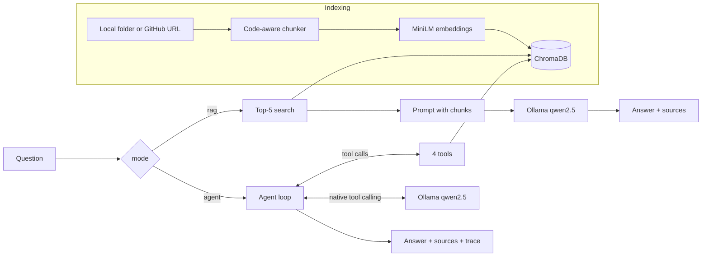

# ⚡ CodeQuery AI — Codebase Q&A Assistant

An AI assistant that lets you **ask questions about any codebase in natural language** and get source-cited answers. It has two modes:

- **RAG**: one semantic search and one LLM call. Fast.
- **Agent**: the model calls tools in a loop (search, list files, read exact lines, summarize a file) until it has enough evidence, and shows every step it took.

Everything runs **locally and for free**: a local Ollama model, local embeddings and a local vector database. No API keys needed.


## 🏗️ Architecture



| Component | Technology |
|-----------|-----------|
| LLM | Ollama `qwen2.5:3b` (local, free, supports tool calling). Configurable with `LLM_MODEL` |
| Embeddings | sentence-transformers/all-MiniLM-L6-v2 (local) |
| Vector DB | ChromaDB (local, persistent) |
| Agent | Native Ollama tool calling, 4 typed tools, at most 6 rounds |
| Eval | 20-question dataset, LLM-as-judge with a local model |
| Backend / UI | FastAPI + vanilla HTML/CSS/JS, plus a CLI |

## 🚀 Quick Start

### 1. Install Ollama and pull the model

```bash
brew install ollama          # or download from https://ollama.com
ollama serve                 # leave this running in its own terminal
ollama pull qwen2.5:3b       # 1.9 GB on disk, about 2.5 GB of RAM while answering
```

> `qwen2.5:7b` gives better answers but needs about 5 GB of RAM. To use it, run `ollama pull qwen2.5:7b` and set `LLM_MODEL=qwen2.5:7b`.

### 2. Install dependencies

```bash
cd backend
pip install -r requirements.txt
python cli.py check          # confirms Ollama is running and the model is pulled
```

> **Note:** First run downloads the embedding model (~80MB). It's cached after that.

If Ollama isn't running or the model is missing, `check`, the server and the CLI all print the exact command to fix it (`ollama serve` or `ollama pull <model>`).

### 3. Run the server and open the app

```bash
python main.py
```

Open [http://localhost:8080](http://localhost:8080). Pick **RAG** or **Agent** under the chat box. Agent answers have a collapsible trace showing each tool call.

### Or use the CLI

```bash
python cli.py index https://github.com/user/repo --name repo
python cli.py ask --repo repo --mode rag "How does login work?"
python cli.py ask --repo repo --mode agent --verbose "How does login work?"
```

`--verbose` prints every agent step: the tool chosen, its arguments, the result size, and the tool and model latency.

### Configuration

All optional. Set them as environment variables or in `backend/.env`:

| Variable | Default | What it does |
|---|---|---|
| `LLM_MODEL` | `qwen2.5:3b` | Ollama model for answers and the agent |
| `JUDGE_MODEL` | same as `LLM_MODEL` | Model the eval uses to grade answers |
| `AGENT_MAX_ITERATIONS` | `6` | Tool-calling rounds before the agent must answer |
| `OLLAMA_HOST` | `http://localhost:11434` | Where Ollama listens |
| `OLLAMA_NUM_CTX` | `8192` | Context window in tokens |
| `LLM_TEMPERATURE` | `0.2` | Sampling temperature (the eval uses 0) |
| `LLM_PROVIDER` | `ollama` | Set to `cloud` to answer RAG questions with Groq/Gemini instead (needs `GROQ_API_KEY` or `GEMINI_API_KEY`) |

## ☁️ Deploy to Hugging Face Spaces

> **Heads-up:** Hugging Face now requires a paid PRO plan to create Docker Spaces, so this path is no longer free for new accounts.

1. Create a free account at [huggingface.co](https://huggingface.co/join)
2. Create a new Space at [huggingface.co/new-space](https://huggingface.co/new-space): name it `codequery-ai`, pick **Docker** → **Blank**
3. In the Space → **Settings** → **Variables and secrets**, add `GROQ_API_KEY` and/or `GEMINI_API_KEY` as **secrets**. The Docker image sets `LLM_PROVIDER=cloud`, because hosted servers don't have the RAM for a local model
4. Create a **Write** token at [huggingface.co/settings/tokens](https://huggingface.co/settings/tokens)
5. Run the deploy script (use your HF username and the token as the password when git asks):

```bash
./deploy.sh YOUR_HF_USERNAME codequery-ai
```

The app will be live at `https://YOUR_HF_USERNAME-codequery-ai.hf.space` after the build finishes.

> **Note:** On a deployed app only GitHub URLs can be indexed (local paths are disabled), and agent mode needs Ollama, so it only works when you run CodeQuery locally.

## 📖 Usage

1. **Index a Repository**: enter a local path (e.g. `/Users/you/project`) or GitHub URL in the sidebar
2. **Select the Repo**: click it in the indexed repositories list
3. **Pick a mode**: RAG for quick lookups, Agent for questions that span several files
4. **Ask Questions**: type natural-language questions about the code

### Example Questions

- "How does authentication work?"
- "Explain the database models and their relationships"
- "What API endpoints are available?"
- "How is error handling implemented?"
- "What design patterns are used in this codebase?"

## 🔧 How It Works

### Indexing (shared by both modes)

Code files are split into logical chunks (respecting function and class boundaries), converted to vector embeddings and stored in ChromaDB with their file path and line range.

### RAG mode

The question is embedded, the 5 most similar chunks are retrieved, and they're sent to the LLM with the question in a single call. The answer cites the files and lines it used.

### Agent mode

The agent ([backend/agent/loop.py](backend/agent/loop.py)) gives the model four tools ([backend/tools/repo_tools.py](backend/tools/repo_tools.py)):

| Tool | What it does |
|---|---|
| `search_docs(query, top_k=5)` | Semantic search; returns passages with file, line range and chunk id |
| `list_documents()` | Lists the indexed files with language, chunk count and length |
| `read_document_section(doc_name, start, end)` | Returns exact numbered lines of a file (up to 150 per call) |
| `summarize_document(doc_name)` | Asks the model for a short summary of one whole file |

Each round:

1. The model gets the conversation so far plus the tool schemas, which are built from each function's type hints and docstring.
2. If it replies with tool calls, the loop checks and converts the arguments, runs the tools, and appends the results as `tool` messages.
3. If it replies with plain text, that's the final answer.
4. After `AGENT_MAX_ITERATIONS` rounds (default 6), the tools are taken away and the model must answer from what it gathered.

The loop never crashes on bad model output. Unknown tool names, malformed or missing arguments, and exceptions inside a tool go back to the model as an error result it can recover from. Tool calls that the model writes as plain text instead of real tool calls (which small Qwen models sometimes do) are recognised too.

Every step is recorded in a trace: the tool, its arguments, the result size, the tool latency and the model latency. The UI shows the trace under each agent answer, and the CLI prints it with `--verbose`.

## 📊 Evaluation

`eval/` holds a small made-up codebase (`eval/sample_repo/`, a library-lending service) and 20 questions about it in `eval/dataset.jsonl`, each with a reference answer:

- 8 single-hop (one fact in one file)
- 8 multi-hop (combining several files or functions)
- 4 unanswerable (the feature doesn't exist, so the right answer is "couldn't find it")

`eval/run_eval.py` runs every question in both modes, then a local judge model scores each answer from 1 to 5 on **correctness**, **faithfulness** to the retrieved sources and **citation quality**, with a one-line justification. The judge must reply in a fixed JSON format, and the parser copes with fenced or slightly broken replies. The runner also records tool calls, model rounds and latency per question.

```bash
backend/venv/bin/python eval/run_eval.py              # all 20 questions, both modes
backend/venv/bin/python eval/run_eval.py --limit 4    # quick partial run
backend/venv/bin/python eval/run_eval.py --resume     # continue a stopped run
```

It prints a comparison table and saves [eval/results.md](eval/results.md) (summary and per-question scores) and `eval/results.jsonl` (every answer). It uses its own index in `eval/.chroma/`, so your indexed repos aren't touched.

> The full run makes about 80 model calls. On an 8 GB M3 MacBook with `qwen2.5:3b` it took about 10 minutes and peaked at 2.3 GB of RAM.

### Results (`qwen2.5:3b` answering and judging, temperature 0)

| Metric | RAG | Agent |
|---|---|---|
| Correctness (1-5) | **4.65** | 3.35 |
| Faithfulness (1-5) | **3.20** | 2.35 |
| Citation quality (1-5) | **3.20** | 2.65 |
| Pass rate (correctness ≥ 4) | **90%** | 50% |
| Correctness: single-hop / multi-hop / unanswerable | 4.25 / 4.88 / 5.00 | 3.75 / 2.62 / 4.00 |
| Avg latency | 11.0 s | 14.7 s |
| Avg tool calls / model rounds | 0 / 1 | 1.4 / 3.0 |
| Crashed runs · hit the 6-round limit · unparseable judge replies | 0 · 0 · 0 | 0 · 0 · 0 |

**What this shows:**

- With a 3B model, **single-shot RAG beats the agent**, and the gap is largest on multi-hop questions. On a small codebase (34 chunks), the top 5 chunks usually contain everything needed. The agent, by contrast, tends to stop after 1–2 tool calls and then draw a wrong conclusion. For example, it once assumed a late-fee rate instead of looking up the constant.
- The eval caught two agent failure modes, which were then fixed. On a 4-question pilot these fixes raised agent correctness from 2.0 to 4.0:
  - The model answered "couldn't find it" without calling any tool. It's now sent back to search once.
  - It asked for too few search results. Searches now return at least 5.
- The loop itself is robust: 0 crashes and 0 runs that hit the iteration limit across all 20 agent runs.
- Caveat: the judge is the same small model, so scores are noisy. For example, it sometimes gave 1/5 for faithfulness to correct "this feature doesn't exist" answers. A larger answer model (e.g. `qwen2.5:7b`) or a different judge model would give a fairer picture. Full per-question scores are in [eval/results.md](eval/results.md).

## 🧪 Tests

```bash
cd backend
pip install -r requirements-dev.txt
pytest -m "not e2e"     # unit and API tests, offline, a few seconds
pytest -m e2e           # browser tests (need Chrome)
```

The tool, agent-loop, Ollama-check and judge tests use fake models, so they run offline without Ollama.

## 📁 Project Structure

```
CodeQuery/
├── backend/
│   ├── main.py              # FastAPI server + API endpoints
│   ├── cli.py               # Command line: check / index / ask --mode rag|agent --verbose
│   ├── config.py            # Settings from env vars / .env (model, iterations, provider)
│   ├── llm.py               # Ollama client + startup check
│   ├── agent/loop.py        # Tool-calling agent loop and trace
│   ├── tools/repo_tools.py  # The 4 agent tools
│   ├── tools/schema.py      # Python function -> tool schema, argument checking
│   ├── rag_engine.py        # Single-shot RAG pipeline (retrieve + generate)
│   ├── chunker.py           # Code-aware text splitting
│   ├── embeddings.py        # Local sentence-transformer embeddings
│   ├── vector_store.py      # ChromaDB wrapper
│   ├── indexer.py           # Repo cloning + file indexing
│   ├── tests/               # pytest suite (unit, API, CLI, Selenium)
│   └── requirements.txt     # Python dependencies
├── eval/
│   ├── sample_repo/         # Small codebase the eval questions are about
│   ├── dataset.jsonl        # 20 questions with reference answers
│   ├── judge.py             # LLM-as-judge prompt and JSON parsing
│   └── run_eval.py          # Runs RAG vs agent and writes results.md
├── frontend/
│   ├── index.html           # Chat UI
│   ├── style.css            # Dark theme styling
│   └── script.js            # Frontend logic
└── README.md
```

## 🛠️ API Endpoints

| Method | Endpoint | Description |
|--------|----------|-------------|
| POST | `/api/index` | Index a codebase (local path or GitHub URL) |
| POST | `/api/query` | Ask a question. Body: `question`, `repo_name`, optional `top_k` and `mode` (`"rag"` or `"agent"`). Agent answers also return `trace`, `tool_calls` and `iterations` |
| GET | `/api/repos` | List all indexed repositories |
| GET | `/api/index-status/{name}` | Check indexing progress |
| DELETE | `/api/repos/{name}` | Delete an indexed repository |
